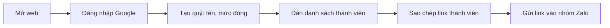
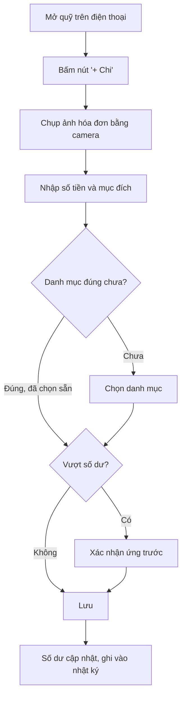
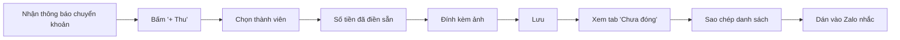
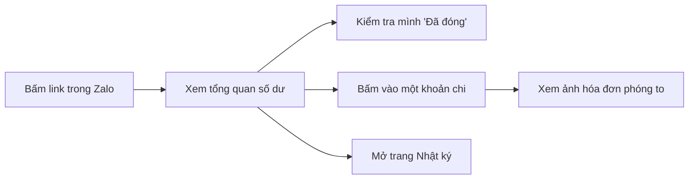
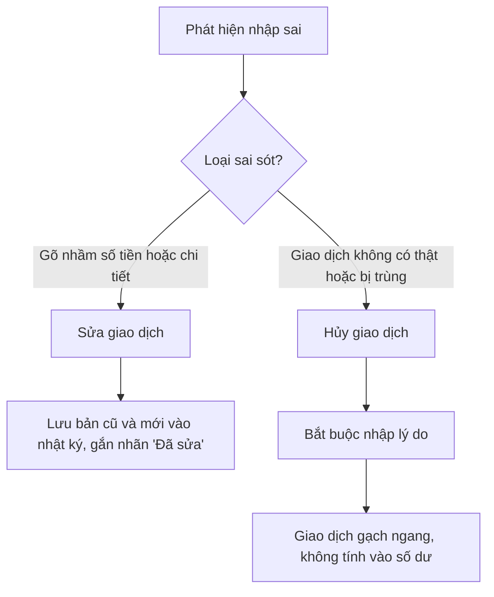

# Bước 2: User Story và luồng sử dụng

**Dự án:** Quỹ Minh Bạch
**Phiên bản tài liệu:** 1.0
**Tài liệu liên quan:** `01-hinh-thanh-y-tuong.md`, `03-phan-tich-yeu-cau.md`

---

## 1. Vai trò

| Mã | Vai trò | Mô tả | Cách truy cập |
|---|---|---|---|
| **TQ** | Thủ quỹ | Người tạo và quản lý quỹ, ghi thu chi | Đăng nhập (Google hoặc email) |
| **TV** | Thành viên | Người đóng tiền vào quỹ | **Link thành viên**, không cần tài khoản |
| **KX** | Khách xem | Nhà tài trợ, người ngoài | **Link công khai**, thông tin cá nhân bị ẩn |

## 2. Quy ước

- **Mẫu user story:** _Là **[vai trò]**, tôi muốn **[hành động]**, để **[lợi ích]**._
- **Mức ưu tiên (MoSCoW):**
  - **Must:** bắt buộc có trong MVP.
  - **Should:** nên có, làm nếu kịp thời gian.
  - **Could:** có thì tốt, làm sau.
  - **Won't:** không làm trong phiên bản này.
- **Điểm ước lượng (SP):** 1 = rất nhỏ, 2 = nhỏ, 3 = vừa, 5 = lớn.
- **Tiêu chí chấp nhận:** viết theo dạng _Cho trước / Khi / Thì_ (Given / When / Then).

## 3. Tổng hợp user story

| Mã | Epic | User story (tóm tắt) | Vai trò | Ưu tiên | SP |
|---|---|---|---|---|:-:|
| US-01 | Tài khoản và quỹ | Đăng nhập | TQ | Must | 2 |
| US-02 | Tài khoản và quỹ | Tạo quỹ mới | TQ | Must | 2 |
| US-03 | Tài khoản và quỹ | Quản lý danh sách thành viên | TQ | Must | 3 |
| US-04 | Tài khoản và quỹ | Sửa thông tin quỹ | TQ | Must | 1 |
| US-05 | Tài khoản và quỹ | Thêm đồng thủ quỹ | TQ | Could | 3 |
| US-06 | Khoản thu | Ghi khoản thu chuyển khoản kèm ảnh | TQ | Must | 3 |
| US-07 | Khoản thu | Ghi khoản thu tiền mặt | TQ | Must | 1 |
| US-08 | Khoản thu | Xem ai đã đóng, ai chưa đóng | TQ, TV | Must | 3 |
| US-09 | Khoản chi | Ghi khoản chi kèm ảnh hóa đơn | TQ | Must | 3 |
| US-10 | Khoản chi | Chọn danh mục chi | TQ | Must | 1 |
| US-11 | Minh bạch | Hủy giao dịch kèm lý do | TQ | Must | 2 |
| US-12 | Minh bạch | Sửa giao dịch, lưu bản cũ | TQ | Must | 3 |
| US-13 | Minh bạch | Xem lịch sử thay đổi | TV | Must | 2 |
| US-14 | Xem và chia sẻ | Xem tổng quan số dư | TV | Must | 2 |
| US-15 | Xem và chia sẻ | Xem chi tiết giao dịch và chứng từ | TV | Must | 2 |
| US-16 | Xem và chia sẻ | Tạo và thu hồi link chia sẻ | TQ | Must | 3 |
| US-17 | Xem và chia sẻ | Xem quỹ qua link công khai | KX | Should | 2 |
| US-18 | Xem và chia sẻ | Biểu đồ chi theo danh mục | TV | Should | 2 |
| US-19 | Xem và chia sẻ | Lọc và tìm giao dịch | TV | Should | 2 |
| US-20 | Báo cáo | Xuất danh sách giao dịch ra CSV | TQ | Could | 2 |
| US-21 | Thanh toán | Mã VietQR cho từng thành viên | TV | Won't | 3 |

**Tổng điểm Must:** 33 SP. **Should:** 6 SP. **Could:** 5 SP.

---

## 4. Chi tiết user story

### Epic 1: Tài khoản và quỹ

#### US-01: Đăng nhập · Must
> Là **thủ quỹ**, tôi muốn **đăng nhập bằng tài khoản Google hoặc email**, để **chỉ mình tôi mới ghi và sửa được dữ liệu quỹ**.

**Tiêu chí chấp nhận**
- **AC1:** _Cho trước_ tôi chưa đăng nhập, _khi_ bấm "Đăng nhập với Google" và cấp quyền, _thì_ tôi được chuyển đến trang danh sách quỹ của mình.
- **AC2:** _Cho trước_ tôi chọn đăng nhập bằng email, _khi_ nhập email và bấm vào link trong hộp thư, _thì_ tôi đăng nhập thành công mà không cần mật khẩu.
- **AC3:** _Cho trước_ tôi chưa đăng nhập, _khi_ truy cập trực tiếp trang ghi giao dịch, _thì_ hệ thống chuyển tôi về trang đăng nhập.

#### US-02: Tạo quỹ mới · Must
> Là **thủ quỹ**, tôi muốn **tạo một quỹ với tên, mô tả và mức đóng mỗi người**, để **bắt đầu quản lý thu chi**.

**Tiêu chí chấp nhận**
- **AC1:** _Khi_ tôi nhập tên quỹ (bắt buộc), mô tả (không bắt buộc), mức đóng mỗi người (không bắt buộc) và bấm "Tạo", _thì_ quỹ mới xuất hiện với số dư 0 đ.
- **AC2:** _Khi_ tôi để trống tên quỹ, _thì_ hệ thống báo lỗi "Vui lòng nhập tên quỹ" và không tạo quỹ.
- **AC3:** Một thủ quỹ có thể quản lý nhiều quỹ.

#### US-03: Quản lý danh sách thành viên · Must
> Là **thủ quỹ**, tôi muốn **thêm thành viên bằng cách dán cả danh sách tên**, để **không phải nhập từng người một**.

**Tiêu chí chấp nhận**
- **AC1:** _Khi_ tôi dán danh sách tên (mỗi dòng một tên, ví dụ copy từ Excel) và bấm "Thêm", _thì_ mỗi dòng không rỗng trở thành một thành viên.
- **AC2:** Dòng trống và khoảng trắng thừa ở đầu, cuối được bỏ qua.
- **AC3:** _Khi_ có tên trùng với thành viên đã có, _thì_ hệ thống cảnh báo và cho tôi chọn bỏ qua hoặc vẫn thêm (vì lớp có thể có hai người trùng tên).
- **AC4:** Tôi có thể sửa tên hoặc đánh dấu "ngưng tham gia" một thành viên. Thành viên đã có giao dịch thì **không xóa được**, chỉ ngưng được.

#### US-04: Sửa thông tin quỹ · Must
> Là **thủ quỹ**, tôi muốn **sửa tên, mô tả và mức đóng của quỹ**, để **cập nhật khi có thay đổi**.

**Tiêu chí chấp nhận**
- **AC1:** _Khi_ tôi đổi mức đóng mỗi người, _thì_ trạng thái đã đóng / chưa đóng của mọi thành viên được tính lại theo mức mới.

#### US-05: Thêm đồng thủ quỹ · Could
> Là **thủ quỹ**, tôi muốn **mời thêm một người cùng quản lý quỹ**, để **có người thay khi tôi bận**.

**Tiêu chí chấp nhận**
- **AC1:** _Khi_ tôi nhập email người được mời, _thì_ sau khi người đó đăng nhập bằng email ấy, họ có quyền ghi thu chi như tôi.
- **AC2:** Mọi giao dịch đều ghi rõ người tạo là ai.

### Epic 2: Khoản thu

#### US-06: Ghi khoản thu chuyển khoản · Must
> Là **thủ quỹ**, tôi muốn **ghi khoản thu kèm ảnh chụp chuyển khoản chỉ trong vài thao tác**, để **ghi nhận ngay khi nhận được tiền**.

**Tiêu chí chấp nhận**
- **AC1:** _Khi_ tôi chọn thành viên, nhập số tiền, chọn "Chuyển khoản", đính kèm ảnh và bấm "Lưu", _thì_ khoản thu xuất hiện trong danh sách và số dư tăng tương ứng.
- **AC2:** Ô số tiền **điền sẵn** mức đóng của quỹ nếu có. Ngày giao dịch mặc định là hôm nay.
- **AC3:** Số tiền phải là số nguyên dương. _Khi_ nhập 0, số âm hoặc chữ, _thì_ hệ thống báo lỗi.
- **AC4:** Có thể mở **camera** trực tiếp hoặc chọn ảnh từ thư viện.
- **AC5:** Toàn bộ thao tác, từ lúc bấm "+ Thu" đến khi lưu xong, mất **không quá 30 giây** với người đã quen dùng.

#### US-07: Ghi khoản thu tiền mặt · Must
> Là **thủ quỹ**, tôi muốn **ghi khoản thu tiền mặt mà không cần ảnh**, để **ghi nhận cả những người đóng tiền trực tiếp**.

**Tiêu chí chấp nhận**
- **AC1:** _Khi_ tôi chọn "Tiền mặt", _thì_ ảnh trở thành không bắt buộc.
- **AC2:** Khoản thu tiền mặt hiển thị nhãn **"Tiền mặt"** rõ ràng ở mọi nơi.

#### US-08: Xem ai đã đóng, ai chưa đóng · Must
> Là **thủ quỹ**, tôi muốn **xem ngay danh sách ai chưa đóng tiền**, để **nhắc đúng người mà không cần dò sổ**.
> Là **thành viên**, tôi muốn **kiểm tra mình đã được ghi nhận đóng tiền chưa**, để **yên tâm và phát hiện sai sót sớm**.

**Tiêu chí chấp nhận**
- **AC1:** Mỗi thành viên có một trong ba trạng thái: **Đã đóng** (tổng đã đóng ≥ mức đóng), **Đóng thiếu** (0 < tổng < mức đóng), **Chưa đóng** (tổng = 0).
- **AC2:** Danh sách có bộ lọc theo trạng thái và hiển thị số lượng từng nhóm, ví dụ "32/40 đã đóng".
- **AC3:** _Cho trước_ quỹ không đặt mức đóng, _thì_ chỉ hiển thị tổng tiền mỗi người đã đóng, không hiện trạng thái.
- **AC4:** Có nút **"Sao chép danh sách chưa đóng"** để dán vào nhóm Zalo.

### Epic 3: Khoản chi

#### US-09: Ghi khoản chi kèm ảnh hóa đơn · Must
> Là **thủ quỹ**, tôi muốn **ghi khoản chi kèm ảnh hóa đơn**, để **mọi người thấy tiền được chi vào đâu và có bằng chứng**.

**Tiêu chí chấp nhận**
- **AC1:** _Khi_ tôi nhập số tiền, mục đích, chọn danh mục, đính kèm ảnh hóa đơn và bấm "Lưu", _thì_ khoản chi xuất hiện và số dư giảm tương ứng.
- **AC2:** **Ảnh hóa đơn là bắt buộc.** _Khi_ không có ảnh, _thì_ không lưu được. Ngoại lệ: tôi tick "Không có hóa đơn" và **bắt buộc ghi lý do**, khi đó khoản chi hiển thị nhãn cảnh báo "Không có chứng từ".
- **AC3:** _Khi_ khoản chi lớn hơn số dư hiện tại, _thì_ hệ thống cảnh báo "Khoản chi vượt số dư" và yêu cầu xác nhận (trường hợp thủ quỹ ứng trước).

#### US-10: Chọn danh mục chi · Must
> Là **thủ quỹ**, tôi muốn **chọn danh mục cho mỗi khoản chi**, để **mọi người thấy tiền chủ yếu chi cho việc gì**.

**Tiêu chí chấp nhận**
- **AC1:** Có sẵn các danh mục mặc định: Ăn uống, In ấn và văn phòng phẩm, Quà tặng, Di chuyển, Thiện nguyện, Khác.
- **AC2:** Danh mục dùng gần nhất được chọn sẵn ở lần ghi tiếp theo.

### Epic 4: Minh bạch

#### US-11: Hủy giao dịch kèm lý do · Must
> Là **thủ quỹ**, tôi muốn **hủy một giao dịch ghi nhầm và ghi rõ lý do**, để **sửa sai mà vẫn minh bạch**.

**Tiêu chí chấp nhận**
- **AC1:** **Không có chức năng xóa giao dịch** ở bất kỳ đâu.
- **AC2:** _Khi_ tôi bấm "Hủy giao dịch", _thì_ hệ thống bắt buộc nhập lý do (tối thiểu 5 ký tự).
- **AC3:** Giao dịch đã hủy **vẫn hiển thị** trong danh sách (gạch ngang, nhãn "Đã hủy" và lý do) nhưng **không được tính** vào số dư.
- **AC4:** Giao dịch đã hủy không thể khôi phục hay sửa. Nếu cần, phải tạo giao dịch mới.

#### US-12: Sửa giao dịch, lưu bản cũ · Must
> Là **thủ quỹ**, tôi muốn **sửa thông tin giao dịch bị nhập sai** (ví dụ gõ nhầm số tiền), để **dữ liệu chính xác**.

**Tiêu chí chấp nhận**
- **AC1:** _Khi_ tôi sửa và lưu, _thì_ hệ thống lưu lại **toàn bộ dữ liệu cũ và mới** trong nhật ký thay đổi.
- **AC2:** Giao dịch đã từng bị sửa hiển thị nhãn **"Đã sửa"** và bấm vào được để xem lịch sử.

#### US-13: Xem lịch sử thay đổi · Must
> Là **thành viên**, tôi muốn **xem mọi lần sửa và hủy giao dịch**, để **chắc chắn không có ai thay đổi dữ liệu lén lút**.

**Tiêu chí chấp nhận**
- **AC1:** Trang "Nhật ký" liệt kê các thay đổi theo thời gian mới nhất trước: thời điểm, người thực hiện, loại thao tác (tạo, sửa, hủy), giá trị trước và sau.
- **AC2:** Nhật ký **chỉ được thêm**, không ai sửa hay xóa được, kể cả thủ quỹ.

### Epic 5: Xem và chia sẻ

#### US-14: Xem tổng quan số dư · Must
> Là **thành viên**, tôi muốn **mở link là thấy ngay số dư, tổng thu, tổng chi**, để **nắm tình hình quỹ trong vài giây**.

**Tiêu chí chấp nhận**
- **AC1:** Trang tổng quan hiển thị: số dư hiện tại, tổng thu, tổng chi, số người đã đóng trên tổng số, 5 giao dịch gần nhất.
- **AC2:** Số tiền hiển thị theo định dạng Việt Nam, ví dụ **1.250.000 đ**.
- **AC3:** Không cần đăng nhập hay cài app. Mở được trong trình duyệt tích hợp của Zalo và Messenger.

#### US-15: Xem chi tiết giao dịch và chứng từ · Must
> Là **thành viên**, tôi muốn **bấm vào một giao dịch để xem ảnh chứng từ phóng to**, để **tự kiểm tra hóa đơn**.

**Tiêu chí chấp nhận**
- **AC1:** Chi tiết giao dịch gồm loại, số tiền, ngày, người đóng hoặc mục đích chi, danh mục, hình thức, người ghi, thời điểm ghi và ảnh chứng từ.
- **AC2:** Bấm vào ảnh thì xem toàn màn hình, phóng to được bằng thao tác hai ngón tay.

#### US-16: Tạo và thu hồi link chia sẻ · Must
> Là **thủ quỹ**, tôi muốn **tạo link xem quỹ và thu hồi khi cần**, để **kiểm soát ai xem được**.

**Tiêu chí chấp nhận**
- **AC1:** Mỗi quỹ có hai loại link: **link thành viên** (xem đầy đủ) và **link công khai** (ẩn thông tin cá nhân). Link công khai mặc định tắt.
- **AC2:** Có nút **"Sao chép link"** để dán vào Zalo.
- **AC3:** _Khi_ tôi bấm "Tạo link mới", _thì_ link cũ **ngừng hoạt động ngay** và người mở link cũ thấy thông báo "Link không còn hiệu lực".
- **AC4:** Link không đoán được: dùng chuỗi ngẫu nhiên, không dùng ID tăng dần.

#### US-17: Xem quỹ qua link công khai · Should
> Là **khách xem (nhà tài trợ)**, tôi muốn **xem quỹ được chi tiêu thế nào**, để **tin tưởng khi tài trợ**.

**Tiêu chí chấp nhận**
- **AC1:** Khách xem thấy số dư, tổng thu, tổng chi, danh sách khoản chi kèm ảnh hóa đơn.
- **AC2:** Khách xem **không thấy** tên người đóng tiền, ảnh chụp chuyển khoản hay danh sách đã đóng / chưa đóng. Khoản thu chỉ hiện dạng "Thành viên đóng quỹ: 100.000 đ".

#### US-18: Biểu đồ chi theo danh mục · Should
> Là **thành viên**, tôi muốn **xem biểu đồ tỷ lệ chi theo danh mục**, để **biết tiền chủ yếu dùng vào việc gì**.

**Tiêu chí chấp nhận**
- **AC1:** Biểu đồ thanh ngang theo danh mục, có số tiền và phần trăm. Không tính giao dịch đã hủy.

#### US-19: Lọc và tìm giao dịch · Should
> Là **thành viên**, tôi muốn **lọc giao dịch theo loại, danh mục, khoảng thời gian và tìm theo từ khóa**, để **tìm nhanh một khoản cụ thể**.

**Tiêu chí chấp nhận**
- **AC1:** Lọc được theo Thu / Chi / Đã hủy, theo danh mục, theo khoảng ngày.
- **AC2:** Tìm theo từ khóa trong ghi chú, mục đích hoặc tên thành viên.

#### US-20: Xuất CSV · Could
> Là **thủ quỹ**, tôi muốn **xuất toàn bộ giao dịch ra file CSV**, để **báo cáo cuối kỳ hoặc lưu trữ**.

**Tiêu chí chấp nhận**
- **AC1:** File mở được bằng Excel và hiển thị đúng tiếng Việt (mã hóa UTF-8 có BOM).

#### US-21: Mã VietQR cho từng thành viên · Won't (phiên bản này)
> Là **thành viên**, tôi muốn **quét mã QR có sẵn số tiền và nội dung chuyển khoản**, để **đóng quỹ nhanh và không ghi sai nội dung**.

_Để dành cho phiên bản 2, đi cùng tính năng tự động khớp giao dịch ngân hàng._

---

## 5. Luồng sử dụng chính

### Luồng 1: Thủ quỹ thiết lập quỹ lần đầu

**Các bước:** US-01 → US-02 → US-03 → US-16
**Mục tiêu:** hoàn tất trong **dưới 3 phút**.

### Luồng 2: Thủ quỹ ghi một khoản chi (luồng dùng nhiều nhất)

**Các bước:** US-09 → US-10
**Mục tiêu:** **không quá 30 giây**.

### Luồng 3: Thủ quỹ thu tiền và nhắc người chưa đóng

**Các bước:** US-06 / US-07 → US-08

### Luồng 4: Thành viên kiểm tra quỹ

**Các bước:** US-14 → US-08 → US-15 → US-13
**Mục tiêu:** không cần tài khoản, thấy số dư ngay **khi trang vừa tải xong**.

### Luồng 5: Thủ quỹ sửa sai

**Các bước:** US-12 / US-11 → US-13

---

## 6. Phạm vi phát hành

| Phiên bản | Gồm user story | Mục tiêu |
|---|---|---|
| **MVP (tuần 1–4)** | Toàn bộ **Must**: US-01 → US-04, US-06 → US-16 | Dùng được cho một lớp hoặc CLB thật |
| **MVP+ (tuần 5–6)** | **Should**: US-17, US-18, US-19 | Hoàn thiện trải nghiệm sau phản hồi |
| **Sau đồ án** | **Could**: US-05, US-20. **Won't**: US-21 | Mở rộng |
