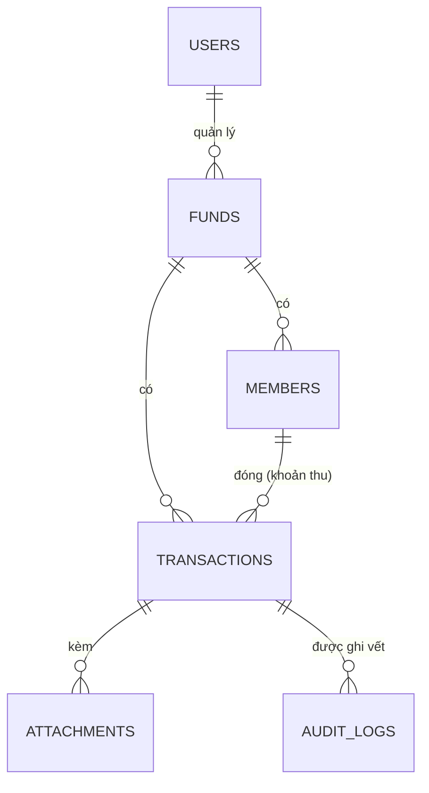

# Bước 3: Phân tích yêu cầu (Requirements Analysis)

**Dự án:** Quỹ Minh Bạch
**Phiên bản tài liệu:** 1.0
**Tài liệu liên quan:** `01-hinh-thanh-y-tuong.md`, `02-user-stories.md`

---

## 1. Giới thiệu

### 1.1. Mục đích tài liệu
Tài liệu này mô tả đầy đủ yêu cầu chức năng, yêu cầu phi chức năng, phạm vi, ràng buộc, dữ liệu, phân quyền và tiêu chí nghiệm thu của hệ thống **Quỹ Minh Bạch** phiên bản MVP. Đây là cơ sở để thiết kế, lập trình, kiểm thử và nghiệm thu.

### 1.2. Mô tả ngắn hệ thống
Web app (chạy trên trình duyệt, ưu tiên điện thoại) giúp thủ quỹ của lớp học, câu lạc bộ hoặc nhóm nhỏ ghi chép thu chi kèm chứng từ. Thành viên xem công khai qua link mà không cần tài khoản. Mọi thay đổi đều được lưu vết và không xóa được.

### 1.3. Thuật ngữ

| Thuật ngữ | Giải thích |
|---|---|
| **Quỹ** | Một tài khoản quỹ chung của một nhóm (ví dụ "Quỹ lớp 12A1 – HK1") |
| **Giao dịch** | Một khoản thu hoặc một khoản chi |
| **Chứng từ** | Ảnh chụp chuyển khoản (khoản thu) hoặc ảnh hóa đơn (khoản chi) |
| **Hủy giao dịch** | Đánh dấu giao dịch không còn hiệu lực. Giao dịch vẫn được lưu và hiển thị, nhưng không tính vào số dư |
| **Nhật ký (audit log)** | Bản ghi chỉ-thêm về mọi thao tác tạo, sửa, hủy giao dịch |
| **Link thành viên** | Đường dẫn bí mật cho thành viên xem đầy đủ quỹ |
| **Link công khai** | Đường dẫn cho người ngoài xem, đã ẩn thông tin cá nhân |
| **Mức đóng** | Số tiền mỗi thành viên cần đóng cho quỹ |
| **RLS** | Row Level Security, phân quyền theo từng dòng dữ liệu ở tầng cơ sở dữ liệu |

---

## 2. Phạm vi

### 2.1. Trong phạm vi (MVP)
- Đăng nhập cho thủ quỹ (Google, email không mật khẩu).
- Tạo và quản lý quỹ, thành viên.
- Ghi khoản thu (chuyển khoản, tiền mặt) và khoản chi kèm ảnh chứng từ.
- Sửa và hủy giao dịch, có nhật ký thay đổi chỉ-thêm.
- Tổng quan số dư, trạng thái đóng tiền của từng thành viên.
- Link thành viên và link công khai, có thể thu hồi.
- **Mã VietQR điền sẵn số tiền + nội dung** cho từng thành viên (tiền chuyển thẳng vào tài khoản thủ quỹ; app không giữ tiền).
- Biểu đồ chi theo danh mục, lọc và tìm giao dịch (Should).

### 2.2. Ngoài phạm vi
- **Không giữ, chuyển hay xử lý tiền thật.** Hệ thống chỉ ghi chép và **tạo mã VietQR** để người đóng tự chuyển vào tài khoản ngân hàng của thủ quỹ. App không nằm trong luồng tiền, không phải dịch vụ trung gian thanh toán.
- Không kết nối API ngân hàng và **không tự động đối soát/khớp giao dịch** (để phiên bản 2 — xem US-22).
- Không nhận tiền vào "ví" trong app rồi cho rút ra (việc này cần giấy phép trung gian thanh toán — ngoài phạm vi và chủ ý tránh).
- Không có app native Android hoặc iOS (chỉ web app).
- Không gửi thông báo đẩy, SMS hay email nhắc nợ tự động.
- Không hỗ trợ nhiều loại tiền tệ (chỉ VND).
- Không có tính năng OCR đọc hóa đơn tự động.

---

## 3. Các bên liên quan và vai trò

| Vai trò | Mô tả | Xác thực |
|---|---|---|
| **Thủ quỹ (TQ)** | Tạo quỹ, ghi, sửa, hủy giao dịch, quản lý thành viên và link | Tài khoản (Google OAuth hoặc email magic link) |
| **Thành viên (TV)** | Xem đầy đủ quỹ | Token trong link thành viên |
| **Khách xem (KX)** | Xem quỹ đã ẩn thông tin cá nhân | Token trong link công khai |
| **Người phát triển** | Xây dựng, triển khai, bảo trì | Quyền quản trị Supabase và Vercel |

---

## 4. Yêu cầu chức năng (Functional Requirements)

### 4.1. Tổng hợp

| Mã | Yêu cầu | User story | Ưu tiên |
|---|---|---|---|
| FR-01 | Xác thực thủ quỹ | US-01 | Must |
| FR-02 | Tạo quỹ | US-02 | Must |
| FR-03 | Sửa thông tin quỹ | US-04 | Must |
| FR-04 | Quản lý thành viên | US-03 | Must |
| FR-05 | Ghi khoản thu | US-06, US-07 | Must |
| FR-06 | Ghi khoản chi | US-09, US-10 | Must |
| FR-07 | Xử lý ảnh chứng từ | US-06, US-09 | Must |
| FR-08 | Sửa giao dịch | US-12 | Must |
| FR-09 | Hủy giao dịch | US-11 | Must |
| FR-10 | Nhật ký thay đổi | US-13 | Must |
| FR-11 | Tổng quan quỹ | US-14 | Must |
| FR-12 | Trạng thái đóng tiền | US-08 | Must |
| FR-13 | Danh sách và chi tiết giao dịch | US-15 | Must |
| FR-14 | Quản lý link chia sẻ | US-16, US-17 | Must (link thành viên) / Should (link công khai) |
| FR-15 | Biểu đồ chi theo danh mục | US-18 | Should |
| FR-16 | Lọc và tìm giao dịch | US-19 | Should |
| FR-17 | Xuất CSV | US-20 | Could |
| FR-18 | Đồng thủ quỹ | US-05 | Could |
| FR-19 | Mã VietQR cho khoản đóng | US-21 | Must |
| FR-20 | Tự động khớp giao dịch ngân hàng | US-22 | Won't |

### 4.2. Mô tả chi tiết

#### FR-01: Xác thực thủ quỹ
- FR-01.1: Hệ thống cho phép đăng nhập bằng Google OAuth.
- FR-01.2: Hệ thống cho phép đăng nhập bằng email qua magic link (không mật khẩu). Link hết hạn sau 1 giờ.
- FR-01.3: Phiên đăng nhập duy trì ít nhất 7 ngày trên cùng thiết bị.
- FR-01.4: Mọi trang quản trị (tạo, sửa giao dịch, quản lý thành viên, link) yêu cầu đăng nhập. Nếu chưa đăng nhập thì chuyển về trang đăng nhập.
- FR-01.5: Có chức năng đăng xuất.

#### FR-02: Tạo quỹ
- FR-02.1: Trường bắt buộc: **tên quỹ** (1–100 ký tự).
- FR-02.2: Trường không bắt buộc: mô tả (≤ 500 ký tự), mức đóng mỗi người (số nguyên ≥ 0, đơn vị VND).
- FR-02.3: Người tạo tự động trở thành thủ quỹ của quỹ đó.
- FR-02.4: Khi tạo quỹ, hệ thống tự sinh **link thành viên** và **link công khai** (link công khai mặc định tắt).

#### FR-03: Sửa thông tin quỹ
- FR-03.1: Thủ quỹ sửa được tên, mô tả và mức đóng.
- FR-03.2: Khi đổi mức đóng, trạng thái đóng tiền (FR-12) được tính lại ngay.

#### FR-04: Quản lý thành viên
- FR-04.1: Thêm một thành viên bằng cách nhập tên (1–100 ký tự).
- FR-04.2: Thêm hàng loạt bằng cách dán văn bản, mỗi dòng một tên. Bỏ dòng trống và cắt khoảng trắng thừa.
- FR-04.3: Cảnh báo khi tên trùng (không phân biệt hoa thường, bỏ khoảng trắng thừa) và cho phép chọn bỏ qua hoặc vẫn thêm.
- FR-04.4: Sửa tên thành viên.
- FR-04.5: Đánh dấu thành viên "ngưng tham gia". Thành viên ngưng tham gia không xuất hiện trong danh sách chọn khi ghi khoản thu mới và không tính vào tổng số người cần đóng, nhưng giao dịch cũ vẫn giữ nguyên.
- FR-04.6: **Không cho phép xóa** thành viên đã có giao dịch. Thành viên chưa có giao dịch nào thì được xóa.

#### FR-05: Ghi khoản thu
- FR-05.1: Trường bắt buộc: thành viên, số tiền, hình thức (Chuyển khoản / Tiền mặt), ngày giao dịch.
- FR-05.2: Trường không bắt buộc: ghi chú (≤ 200 ký tự).
- FR-05.3: Hình thức "Chuyển khoản" thì **bắt buộc có ảnh**. Hình thức "Tiền mặt" thì ảnh không bắt buộc.
- FR-05.4: Số tiền điền sẵn bằng mức đóng (nếu có) trừ đi số thành viên đó đã đóng, tối thiểu bằng 0.
- FR-05.5: Ngày giao dịch mặc định là ngày hiện tại, không được chọn ngày trong tương lai.
- FR-05.6: Sau khi lưu, ghi một bản ghi `create` vào nhật ký (FR-10).

#### FR-06: Ghi khoản chi
- FR-06.1: Trường bắt buộc: số tiền, mục đích (1–200 ký tự), danh mục, ngày giao dịch, ảnh hóa đơn.
- FR-06.2: Ngoại lệ ảnh: nếu chọn "Không có hóa đơn" thì bắt buộc nhập lý do (≥ 5 ký tự), và giao dịch được gắn cờ `no_receipt = true`.
- FR-06.3: Danh mục mặc định: Ăn uống, In ấn và văn phòng phẩm, Quà tặng, Di chuyển, Thiện nguyện, Khác.
- FR-06.4: Danh mục dùng gần nhất trong quỹ được chọn sẵn.
- FR-06.5: Nếu số tiền chi lớn hơn số dư hiện tại, hiển thị hộp xác nhận "Khoản chi vượt số dư X đ. Vẫn lưu?". Chỉ lưu khi người dùng xác nhận.
- FR-06.6: Sau khi lưu, ghi một bản ghi `create` vào nhật ký.

#### FR-07: Xử lý ảnh chứng từ
- FR-07.1: Cho phép chụp trực tiếp bằng camera hoặc chọn từ thư viện ảnh.
- FR-07.2: Chấp nhận JPEG, PNG, WEBP, HEIC (nếu trình duyệt hỗ trợ). Ảnh gốc tối đa 15 MB.
- FR-07.3: **Nén ảnh phía trình duyệt** trước khi tải lên: cạnh dài tối đa 1600 px, dung lượng sau nén ≤ 500 KB.
- FR-07.4: Hiển thị thanh tiến trình khi tải ảnh. Nếu tải lỗi thì cho phép thử lại mà không mất dữ liệu đã nhập.
- FR-07.5: Mỗi giao dịch có tối đa 3 ảnh.
- FR-07.6: Ảnh lưu trong kho lưu trữ riêng tư, chỉ truy cập qua URL ký số có thời hạn (signed URL), không dùng URL công khai vĩnh viễn.

#### FR-08: Sửa giao dịch
- FR-08.1: Thủ quỹ sửa được mọi trường của giao dịch **đang hiệu lực** (`status = active`), trừ loại giao dịch (thu hay chi).
- FR-08.2: Mỗi lần sửa, ghi vào nhật ký bản ghi `update` gồm dữ liệu cũ và mới đầy đủ.
- FR-08.3: Giao dịch đã sửa hiển thị nhãn "Đã sửa", bấm vào xem được lịch sử của riêng giao dịch đó.
- FR-08.4: Không sửa được giao dịch đã hủy.

#### FR-09: Hủy giao dịch
- FR-09.1: **Hệ thống không có chức năng xóa giao dịch** ở cả giao diện lẫn API.
- FR-09.2: Hủy giao dịch bắt buộc nhập lý do (5–200 ký tự).
- FR-09.3: Giao dịch bị hủy chuyển `status = voided`, lưu lý do, người hủy và thời điểm hủy.
- FR-09.4: Giao dịch đã hủy vẫn hiển thị (gạch ngang, nhãn "Đã hủy" kèm lý do) và không tính vào số dư, thống kê hay trạng thái đóng tiền.
- FR-09.5: Không khôi phục được giao dịch đã hủy.
- FR-09.6: Ghi bản ghi `void` vào nhật ký.

#### FR-10: Nhật ký thay đổi
- FR-10.1: Ghi lại mọi thao tác `create`, `update`, `void` trên giao dịch: thời điểm, người thực hiện, mã giao dịch, dữ liệu trước, dữ liệu sau.
- FR-10.2: Nhật ký **chỉ-thêm (append-only)**. Không vai trò nào, kể cả thủ quỹ, sửa hay xóa được. Ràng buộc này phải được thực thi ở **tầng cơ sở dữ liệu**, không chỉ ở giao diện.
- FR-10.3: Nhật ký được ghi tự động bằng trigger trong cơ sở dữ liệu, đảm bảo không có thay đổi nào lọt qua mà không có bản ghi.
- FR-10.4: Thành viên xem được trang Nhật ký, sắp xếp mới nhất trước, có phân trang (20 bản ghi một trang).
- FR-10.5: Hiển thị phần thay đổi dễ đọc, ví dụ "Số tiền: ~~150.000 đ~~ → 1.500.000 đ".

#### FR-11: Tổng quan quỹ
- FR-11.1: Hiển thị số dư, tổng thu, tổng chi, số thành viên đã đóng trên tổng số, 5 giao dịch gần nhất.
- FR-11.2: **Số dư luôn được tính** từ giao dịch: `Σ thu (active) − Σ chi (active)`. Không lưu số dư thành một trường riêng.
- FR-11.3: Số dư âm hiển thị màu đỏ kèm chú thích "Thủ quỹ đang ứng trước".

#### FR-12: Trạng thái đóng tiền
- FR-12.1: Với mỗi thành viên đang tham gia, tính `đã đóng = Σ thu (active) của thành viên đó`.
- FR-12.2: Nếu quỹ có mức đóng M > 0:
  - **Đã đóng** khi đã đóng ≥ M.
  - **Đóng thiếu** khi 0 < đã đóng < M.
  - **Chưa đóng** khi đã đóng = 0.
- FR-12.3: Nếu quỹ không có mức đóng (M = 0 hoặc trống), chỉ hiển thị số tiền đã đóng, không hiện trạng thái.
- FR-12.4: Lọc theo trạng thái, hiển thị số lượng mỗi nhóm.
- FR-12.5: Nút "Sao chép danh sách chưa đóng" sao chép văn bản dạng `Các bạn chưa đóng quỹ [tên quỹ]: Tên A, Tên B, ...` vào bộ nhớ tạm.

#### FR-13: Danh sách và chi tiết giao dịch
- FR-13.1: Danh sách giao dịch sắp xếp theo ngày giao dịch mới nhất trước, phân trang hoặc cuộn vô hạn (20 giao dịch một lần tải).
- FR-13.2: Mỗi dòng hiển thị: biểu tượng thu hoặc chi, số tiền (thu màu xanh có dấu +, chi màu đỏ có dấu −), mô tả, ngày, nhãn (Tiền mặt / Không có chứng từ / Đã sửa / Đã hủy).
- FR-13.3: Trang chi tiết hiển thị đầy đủ các trường, ảnh chứng từ, người ghi và thời điểm ghi.
- FR-13.4: Ảnh xem được toàn màn hình, hỗ trợ phóng to bằng thao tác hai ngón tay.

#### FR-14: Quản lý link chia sẻ
- FR-14.1: Mỗi quỹ có một **token thành viên** và một **token công khai**, là chuỗi ngẫu nhiên an toàn mật mã dài ít nhất 128 bit (ví dụ 22 ký tự base64url).
- FR-14.2: Thủ quỹ sao chép link bằng một nút bấm.
- FR-14.3: Thủ quỹ bật hoặc tắt link công khai.
- FR-14.4: "Tạo link mới" sinh token mới, token cũ **mất hiệu lực ngay lập tức**.
- FR-14.5: Truy cập bằng token không hợp lệ hoặc đã thu hồi sẽ hiện trang "Link không còn hiệu lực. Vui lòng xin link mới từ thủ quỹ."
- FR-14.6: Link công khai **ẩn**: tên người đóng tiền, ảnh chứng từ khoản thu, danh sách trạng thái đóng tiền, ghi chú khoản thu. Link công khai **hiện**: số dư, tổng thu, tổng chi, khoản chi kèm ảnh hóa đơn, nhật ký (đã ẩn tên thành viên).

#### FR-15: Biểu đồ chi theo danh mục (Should)
- FR-15.1: Biểu đồ thanh ngang, mỗi thanh là một danh mục kèm số tiền và phần trăm, sắp xếp giảm dần.
- FR-15.2: Chỉ tính các khoản chi đang hiệu lực.

#### FR-16: Lọc và tìm giao dịch (Should)
- FR-16.1: Lọc theo loại (Thu / Chi / Đã hủy), danh mục, khoảng ngày. Kết hợp được nhiều bộ lọc.
- FR-16.2: Tìm theo từ khóa trong mục đích, ghi chú, tên thành viên, không phân biệt dấu tiếng Việt và hoa thường.

#### FR-17: Xuất CSV (Could)
- FR-17.1: Xuất toàn bộ giao dịch (gồm cả giao dịch đã hủy) với các cột: ngày, loại, số tiền, thành viên hoặc mục đích, danh mục, hình thức, trạng thái, lý do hủy, người ghi.
- FR-17.2: Mã hóa UTF-8 có BOM để Excel hiển thị đúng tiếng Việt.

#### FR-18: Đồng thủ quỹ (Could)
- FR-18.1: Thủ quỹ chính mời người khác qua email. Khi người đó đăng nhập bằng email ấy thì có quyền như thủ quỹ, trừ quyền mời hoặc gỡ thủ quỹ khác.

#### FR-19: Mã VietQR cho khoản đóng (Must)
- FR-19.1: Thủ quỹ nhập thông tin nhận tiền của quỹ: **ngân hàng** (chọn từ danh sách, lưu mã BIN Napas), **số tài khoản**, **tên chủ tài khoản**, và **tiền tố nội dung** (không bắt buộc, ví dụ `QUY12A1`). Các trường này không bắt buộc khi tạo quỹ; thiếu thì chỉ không hiện QR.
- FR-19.2: Khi quỹ đã có đủ thông tin nhận tiền, hệ thống sinh **mã VietQR** theo chuẩn **EMVCo/Napas VietQR** (dịch vụ chuyển nhanh NAPAS247, mã tiền tệ 704 - VND), có **điểm kiểm tra CRC-16/CCITT**.
- FR-19.3: Số tiền trong QR **điền sẵn** bằng `max(0, mức đóng − số thành viên đó đã đóng)`. Nếu quỹ không đặt mức đóng, QR để **trống số tiền** (người đóng tự nhập).
- FR-19.4: Nội dung chuyển khoản điền sẵn theo mẫu `[tiền tố] [TÊN THÀNH VIÊN viết hoa, bỏ dấu]`, cắt tối đa theo giới hạn độ dài của trường nội dung VietQR.
- FR-19.5: Trang hiển thị QR có nút **"Lưu ảnh QR"** và **"Sao chép nội dung chuyển khoản"** (dự phòng khi không quét trực tiếp được).
- FR-19.6: **Chuỗi VietQR được sinh hoàn toàn phía client/máy chủ của hệ thống** (hàm thuần), **không gửi số tài khoản tới dịch vụ bên thứ ba**. Ảnh QR được vẽ tại chỗ.
- FR-19.7: App **không** tạo giao dịch khi có người quét QR. Thủ quỹ vẫn ghi nhận khoản thu (FR-05) sau khi tiền về. Tự động khớp là FR-20 (phiên bản sau).
- FR-19.8: Mã VietQR hiển thị cho **thủ quỹ và thành viên** (qua link thành viên). **Không** hiển thị ở link công khai (vì gắn với việc đóng tiền của thành viên).

#### FR-20: Tự động khớp giao dịch ngân hàng (Won't — phiên bản sau)
- FR-20.1: Nhận webhook biến động số dư từ dịch vụ bên thứ ba (SePay/Casso), tạo khoản thu và khớp với thành viên theo nội dung chuyển khoản. Endpoint phải **idempotent** theo mã giao dịch ngân hàng để một biến động không bị ghi hai lần. Vẫn không giữ tiền.

---

## 5. Quy tắc nghiệp vụ (Business Rules)

| Mã | Quy tắc |
|---|---|
| BR-01 | Số tiền là **số nguyên dương**, đơn vị VND, tối đa 1.000.000.000 đ cho một giao dịch |
| BR-02 | Số dư = Σ thu (active) − Σ chi (active). Không lưu thành trường riêng |
| BR-03 | Không xóa giao dịch, chỉ hủy kèm lý do |
| BR-04 | Nhật ký chỉ-thêm, không ai sửa hay xóa được |
| BR-05 | Khoản chi bắt buộc có ảnh hóa đơn, trừ khi khai báo "Không có hóa đơn" kèm lý do |
| BR-06 | Khoản thu chuyển khoản bắt buộc có ảnh. Khoản thu tiền mặt thì không bắt buộc |
| BR-07 | Ngày giao dịch không được ở tương lai |
| BR-08 | Thành viên đã có giao dịch thì không xóa được, chỉ ngưng tham gia |
| BR-09 | Thu hồi link sẽ vô hiệu hóa token cũ ngay lập tức |
| BR-10 | Mỗi giao dịch luôn ghi lại người tạo (`created_by`) và thời điểm tạo do máy chủ cấp, người dùng không sửa được |
| BR-11 | App **không giữ, không trung chuyển tiền**. VietQR chỉ chuyển tiền thẳng vào tài khoản ngân hàng của thủ quỹ; "rút tiền" nghĩa là ghi một khoản chi, không phải lệnh chuyển tiền thật |

---

## 6. Yêu cầu dữ liệu

### 6.1. Sơ đồ quan hệ

### 6.2. Chi tiết các bảng

#### `funds`: quỹ
| Trường | Kiểu | Ràng buộc | Ghi chú |
|---|---|---|---|
| id | uuid | PK | |
| owner_id | uuid | FK → auth.users, NOT NULL | Thủ quỹ chính |
| name | text | NOT NULL, 1–100 ký tự | |
| description | text | ≤ 500 ký tự | |
| target_per_member | bigint | ≥ 0, mặc định 0 | Mức đóng (VND) |
| bank_bin | text | | Mã BIN Napas của ngân hàng (VietQR) |
| bank_account_number | text | | Số tài khoản nhận tiền của thủ quỹ |
| bank_account_name | text | | Tên chủ tài khoản |
| transfer_prefix | text | ≤ 20 ký tự | Tiền tố nội dung CK, ví dụ `QUY12A1` |
| member_token | text | UNIQUE, NOT NULL | Token link thành viên |
| public_token | text | UNIQUE, NOT NULL | Token link công khai |
| public_enabled | boolean | mặc định false | |
| created_at | timestamptz | mặc định now() | |

#### `members`: thành viên
| Trường | Kiểu | Ràng buộc | Ghi chú |
|---|---|---|---|
| id | uuid | PK | |
| fund_id | uuid | FK → funds, NOT NULL | |
| name | text | NOT NULL, 1–100 ký tự | |
| is_active | boolean | mặc định true | false = ngưng tham gia |
| created_at | timestamptz | mặc định now() | |

#### `transactions`: giao dịch
| Trường | Kiểu | Ràng buộc | Ghi chú |
|---|---|---|---|
| id | uuid | PK | |
| fund_id | uuid | FK → funds, NOT NULL | |
| type | text | `income` \| `expense` | Không sửa được sau khi tạo |
| amount | bigint | > 0, ≤ 1.000.000.000 | VND, số nguyên |
| member_id | uuid | FK → members | Bắt buộc nếu `income` |
| purpose | text | ≤ 200 ký tự | Bắt buộc nếu `expense` |
| category | text | | Bắt buộc nếu `expense` |
| payment_method | text | `transfer` \| `cash` | Bắt buộc nếu `income` |
| note | text | ≤ 200 ký tự | |
| no_receipt | boolean | mặc định false | Khoản chi không có hóa đơn |
| no_receipt_reason | text | | Bắt buộc nếu `no_receipt = true` |
| txn_date | date | NOT NULL, ≤ hôm nay | Ngày phát sinh |
| status | text | `active` \| `voided`, mặc định `active` | |
| void_reason | text | 5–200 ký tự | Bắt buộc nếu `voided` |
| voided_by | uuid | FK → auth.users | |
| voided_at | timestamptz | | |
| created_by | uuid | FK → auth.users, NOT NULL | Do máy chủ gán |
| created_at | timestamptz | mặc định now() | Do máy chủ gán |
| updated_at | timestamptz | | |

#### `attachments`: ảnh chứng từ
| Trường | Kiểu | Ràng buộc | Ghi chú |
|---|---|---|---|
| id | uuid | PK | |
| transaction_id | uuid | FK → transactions, NOT NULL | Tối đa 3 ảnh một giao dịch |
| storage_path | text | NOT NULL | Đường dẫn trong bucket riêng tư |
| size_bytes | integer | ≤ 512.000 | Sau khi nén |
| created_at | timestamptz | mặc định now() | |

#### `audit_logs`: nhật ký
| Trường | Kiểu | Ràng buộc | Ghi chú |
|---|---|---|---|
| id | bigint | PK, tự tăng | |
| fund_id | uuid | FK → funds, NOT NULL | Để truy vấn theo quỹ |
| transaction_id | uuid | FK → transactions, NOT NULL | |
| action | text | `create` \| `update` \| `void` | |
| old_data | jsonb | | null nếu `create` |
| new_data | jsonb | NOT NULL | |
| actor_id | uuid | FK → auth.users, NOT NULL | |
| created_at | timestamptz | mặc định now() | |

> **Ràng buộc bất biến:** bảng `audit_logs` chỉ cho phép `INSERT`, thực hiện bởi trigger trên `transactions`. Không có chính sách RLS nào cho phép `UPDATE` hay `DELETE`. Bảng `transactions` không có chính sách cho phép `DELETE`.

### 6.3. Dữ liệu cá nhân
- Dữ liệu cá nhân được lưu: email thủ quỹ, họ tên thành viên, ảnh chuyển khoản (có thể chứa họ tên, số tài khoản ngân hàng).
- Chỉ thu thập dữ liệu tối thiểu cần thiết. Không thu thập số điện thoại, CCCD hay ngày sinh.
- Có trang "Chính sách quyền riêng tư" ngắn gọn, nêu rõ dữ liệu nào được lưu và ai xem được, phù hợp quy định về bảo vệ dữ liệu cá nhân của Việt Nam.
- Hướng dẫn thủ quỹ cắt hoặc che số tài khoản trong ảnh trước khi tải lên nếu cần.

---

## 7. Phân quyền truy cập

### 7.1. Ma trận quyền

| Chức năng | Thủ quỹ | Thành viên (link TV) | Khách xem (link công khai) | Chưa có link |
|---|:-:|:-:|:-:|:-:|
| Tạo quỹ | ✅ | ❌ | ❌ | ❌ |
| Sửa thông tin quỹ | ✅ | ❌ | ❌ | ❌ |
| Quản lý thành viên | ✅ | ❌ | ❌ | ❌ |
| Ghi, sửa, hủy giao dịch | ✅ | ❌ | ❌ | ❌ |
| Xóa giao dịch | ❌ | ❌ | ❌ | ❌ |
| Sửa, xóa nhật ký | ❌ | ❌ | ❌ | ❌ |
| Quản lý link chia sẻ | ✅ | ❌ | ❌ | ❌ |
| Xem số dư, tổng thu, tổng chi | ✅ | ✅ | ✅ | ❌ |
| Xem khoản chi và ảnh hóa đơn | ✅ | ✅ | ✅ | ❌ |
| Xem tên người đóng tiền | ✅ | ✅ | ❌ | ❌ |
| Xem ảnh chuyển khoản (khoản thu) | ✅ | ✅ | ❌ | ❌ |
| Xem trạng thái đã đóng / chưa đóng | ✅ | ✅ | ❌ | ❌ |
| Xem nhật ký | ✅ | ✅ | ✅ (ẩn tên thành viên) | ❌ |
| Gắn/sửa tài khoản ngân hàng của quỹ | ✅ | ❌ | ❌ | ❌ |
| Xem mã VietQR để đóng quỹ | ✅ | ✅ | ❌ | ❌ |
| Xuất CSV | ✅ | ❌ | ❌ | ❌ |

### 7.2. Cơ chế thực thi
- Phân quyền được thực thi ở **tầng cơ sở dữ liệu** bằng RLS của Supabase, không chỉ ẩn nút trên giao diện.
- Truy cập bằng token (thành viên, khách xem) đi qua các hàm phía máy chủ (RPC hoặc API route). Các hàm này kiểm tra token, rồi trả về **đúng phần dữ liệu** được phép xem. Dữ liệu bị ẩn không được gửi xuống trình duyệt.
- Mỗi thủ quỹ chỉ thấy và thao tác được trên các quỹ do mình quản lý.

---

## 8. Yêu cầu phi chức năng (Non-functional Requirements)

### 8.1. Hiệu năng
| Mã | Yêu cầu | Chỉ số đo |
|---|---|---|
| NFR-P1 | Trang tổng quan tải nhanh trên mạng di động | Hiển thị số dư (LCP) ≤ **2,5 giây** trên 4G, điện thoại tầm trung |
| NFR-P2 | Lưu giao dịch (không tính tải ảnh) phản hồi nhanh | ≤ **1 giây** |
| NFR-P3 | Tải ảnh đã nén | ≤ **3 giây** cho ảnh 500 KB trên 4G |
| NFR-P4 | Quy mô một quỹ | Hoạt động mượt với 200 thành viên và 2.000 giao dịch |
| NFR-P5 | Dung lượng JavaScript tải lần đầu | ≤ 250 KB (gzip) |

### 8.2. Khả năng sử dụng
| Mã | Yêu cầu |
|---|---|
| NFR-U1 | **Mobile-first:** hiển thị tốt từ màn hình rộng 360 px trở lên, không cuộn ngang |
| NFR-U2 | Ghi một khoản chi (đã quen dùng) mất **≤ 30 giây** và **≤ 6 lần chạm** |
| NFR-U3 | Thiết lập quỹ lần đầu (tạo quỹ, thêm 40 thành viên, lấy link) mất **≤ 3 phút** |
| NFR-U4 | Giao diện **hoàn toàn bằng tiếng Việt**, có dấu, văn phong thân thiện |
| NFR-U5 | Định dạng tiền Việt Nam: `1.250.000 đ`. Định dạng ngày: `21/11/2026` |
| NFR-U6 | Ô nhập số tiền hiện bàn phím số trên điện thoại và tự thêm dấu chấm phân cách khi gõ |
| NFR-U7 | Vùng chạm tối thiểu 44 × 44 px. Cỡ chữ nội dung tối thiểu 16 px |
| NFR-U8 | Thông báo lỗi nói rõ lỗi gì và cách sửa (ví dụ "Vui lòng đính kèm ảnh hóa đơn") |
| NFR-U9 | Độ tương phản màu đạt WCAG 2.1 mức AA. Không chỉ dùng màu để truyền tải ý nghĩa: thu và chi có cả dấu +/− và biểu tượng |
| NFR-U10 | Người dùng mới hiểu được trang tổng quan mà không cần hướng dẫn: 4/5 người thử nói đúng số dư trong 10 giây |

### 8.3. Bảo mật
| Mã | Yêu cầu |
|---|---|
| NFR-S1 | Toàn bộ kết nối qua **HTTPS** |
| NFR-S2 | Bật RLS trên mọi bảng. Không bảng nào truy cập được bằng anon key mà không qua chính sách |
| NFR-S3 | Token link sinh bằng bộ sinh số ngẫu nhiên an toàn mật mã, ≥ 128 bit |
| NFR-S4 | Ảnh lưu trong bucket **riêng tư**, truy cập qua signed URL hết hạn sau ≤ 1 giờ |
| NFR-S5 | Không lộ service role key ra phía trình duyệt |
| NFR-S6 | Kiểm tra và làm sạch dữ liệu đầu vào ở phía máy chủ (độ dài, kiểu dữ liệu, giá trị cho phép) |
| NFR-S7 | Giới hạn tần suất truy cập bằng token (ví dụ ≤ 60 lượt mỗi phút mỗi IP) để chống dò token |
| NFR-S8 | Trang xem qua token gắn thẻ `noindex` để không bị công cụ tìm kiếm lập chỉ mục |

### 8.4. Toàn vẹn dữ liệu
| Mã | Yêu cầu |
|---|---|
| NFR-I1 | Số tiền lưu kiểu số nguyên (`bigint`), không dùng số thực |
| NFR-I2 | Ghi giao dịch và ghi nhật ký nằm trong **cùng một transaction** cơ sở dữ liệu: cùng thành công hoặc cùng thất bại |
| NFR-I3 | Không có đường nào (giao diện, API, SQL qua anon hoặc authenticated key) xóa được giao dịch hay sửa được nhật ký |
| NFR-I4 | Thời điểm tạo và người tạo do máy chủ gán, không nhận từ phía trình duyệt |

### 8.5. Tương thích
| Mã | Yêu cầu |
|---|---|
| NFR-C1 | Chạy được trên Chrome Android (2 phiên bản gần nhất), Safari iOS 16 trở lên, Chrome và Edge trên máy tính |
| NFR-C2 | **Mở được trong trình duyệt tích hợp của Zalo và Messenger** (người dùng chủ yếu bấm link từ đây) |
| NFR-C3 | Chụp ảnh bằng camera hoạt động trên cả Android và iOS |

### 8.6. Độ tin cậy và khả dụng
| Mã | Yêu cầu |
|---|---|
| NFR-R1 | Dựa trên hạ tầng của nhà cung cấp (Vercel, Supabase), mục tiêu khả dụng ≥ 99% |
| NFR-R2 | Nếu mất mạng lúc đang nhập, dữ liệu trong form không bị mất. Hiện thông báo và cho thử lại |
| NFR-R3 | Sao lưu cơ sở dữ liệu theo cơ chế của Supabase. Định kỳ xuất bản sao lưu thủ công mỗi tuần trong giai đoạn thử nghiệm |

### 8.7. Khả năng bảo trì
| Mã | Yêu cầu |
|---|---|
| NFR-M1 | Mã nguồn quản lý bằng Git, có README hướng dẫn cài đặt và chạy |
| NFR-M2 | Schema cơ sở dữ liệu, chính sách RLS và trigger được viết dưới dạng file migration SQL |
| NFR-M3 | Có kiểm thử tự động cho các quy tắc quan trọng: tính số dư, trạng thái đóng tiền, không xóa được giao dịch, nhật ký chỉ-thêm |

---

## 9. Ràng buộc

| Loại | Ràng buộc |
|---|---|
| **Thời gian** | 6 tuần: 4 tuần cho MVP, 2 tuần thử nghiệm thật và hoàn thiện |
| **Nhân lực** | 1–2 người |
| **Chi phí** | 0 đồng: dùng gói miễn phí của Supabase và Vercel. Thiết kế dung lượng (nén ảnh ≤ 500 KB) để nằm trong giới hạn gói miễn phí |
| **Công nghệ** | Next.js (React) + Tailwind CSS, Supabase (PostgreSQL, Auth, Storage), triển khai trên Vercel |
| **Nền tảng** | Chỉ web app, không có app native |
| **Pháp lý** | Hệ thống không giữ hay chuyển tiền, chỉ ghi chép. Tuân thủ quy định bảo vệ dữ liệu cá nhân ở mức thu thập tối thiểu và công khai mục đích |
| **Ngôn ngữ và tiền tệ** | Chỉ tiếng Việt, chỉ VND |

## 10. Giả định và rủi ro

### 10.1. Giả định
- Thủ quỹ có điện thoại thông minh có camera và kết nối Internet.
- Thành viên nhận link qua nhóm chat (Zalo, Messenger).
- Có ít nhất một lớp hoặc CLB đồng ý dùng thử trong 2 tuần cuối.

### 10.2. Rủi ro

| Rủi ro | Khả năng | Ảnh hưởng | Biện pháp |
|---|:-:|:-:|---|
| Thủ quỹ thấy nhập lâu hơn Excel nên bỏ dùng | Trung bình | Cao | Tối ưu luồng ghi (NFR-U2), thử với người dùng thật từ tuần 3 |
| Link thành viên bị chia sẻ ra ngoài | Trung bình | Trung bình | Chức năng thu hồi link (FR-14.4), hướng dẫn che thông tin nhạy cảm |
| Trình duyệt trong Zalo xử lý camera hoặc upload lỗi | Trung bình | Cao | Kiểm thử sớm trên Zalo (NFR-C2), có nút "Mở bằng trình duyệt" dự phòng |
| Vượt giới hạn gói miễn phí | Thấp | Trung bình | Nén ảnh, giới hạn 3 ảnh mỗi giao dịch, theo dõi dung lượng |
| Cấu hình RLS sai làm lộ dữ liệu | Thấp | Cao | Viết kiểm thử phân quyền, rà soát chính sách trước khi cho dùng thật |

---

## 11. Tiêu chí nghiệm thu

### 11.1. Kịch bản kiểm thử nghiệm thu chức năng

| Mã | Yêu cầu | Kịch bản kiểm thử | Kết quả mong đợi |
|---|---|---|---|
| AT-01 | FR-01 | Truy cập trang ghi giao dịch khi chưa đăng nhập | Bị chuyển về trang đăng nhập |
| AT-02 | FR-01 | Đăng nhập bằng Google | Vào được trang danh sách quỹ |
| AT-03 | FR-02 | Tạo quỹ với tên trống | Báo lỗi, không tạo |
| AT-04 | FR-02 | Tạo quỹ "Quỹ 12A1", mức đóng 100.000 | Quỹ mới, số dư 0 đ, có link thành viên |
| AT-05 | FR-04 | Dán 40 tên (có 2 dòng trống, 1 tên trùng) | Thêm 39 tên mới. Hiện cảnh báo trùng cho 1 tên |
| AT-06 | FR-04 | Xóa thành viên đã có khoản thu | Không cho xóa, gợi ý "Ngưng tham gia" |
| AT-07 | FR-05 | Ghi thu chuyển khoản không có ảnh | Không lưu được, báo cần ảnh |
| AT-08 | FR-05 | Ghi thu tiền mặt 100.000 đ không có ảnh | Lưu thành công, nhãn "Tiền mặt", số dư +100.000 đ |
| AT-09 | FR-05 | Nhập số tiền 0, −5000, "abc" | Báo lỗi cho cả ba trường hợp |
| AT-10 | FR-05 | Chọn ngày giao dịch là ngày mai | Không cho chọn hoặc báo lỗi |
| AT-11 | FR-06 | Ghi chi không có ảnh, không tick "Không có hóa đơn" | Không lưu được |
| AT-12 | FR-06 | Ghi chi, tick "Không có hóa đơn" kèm lý do | Lưu được, nhãn "Không có chứng từ" |
| AT-13 | FR-06 | Số dư 50.000 đ, ghi chi 80.000 đ | Hiện cảnh báo vượt số dư. Xác nhận thì lưu, số dư −30.000 đ màu đỏ |
| AT-14 | FR-07 | Tải ảnh gốc 6 MB | Ảnh sau nén ≤ 500 KB, tải lên thành công |
| AT-15 | FR-07 | Mở URL ảnh sau khi signed URL hết hạn | Không truy cập được |
| AT-16 | FR-08 | Sửa số tiền 150.000 → 1.500.000 | Số dư cập nhật, nhãn "Đã sửa", nhật ký có bản ghi chứa cả giá trị cũ và mới |
| AT-17 | FR-09 | Hủy giao dịch không nhập lý do | Không cho hủy |
| AT-18 | FR-09 | Hủy khoản thu 100.000 đ kèm lý do | Giao dịch gạch ngang, nhãn "Đã hủy", số dư −100.000 đ, trạng thái đóng tiền của thành viên cập nhật |
| AT-19 | FR-09 | Gọi trực tiếp API hoặc SQL `DELETE` giao dịch bằng tài khoản thủ quỹ | Bị từ chối |
| AT-20 | FR-10 | Gọi trực tiếp `UPDATE` hoặc `DELETE` trên `audit_logs` bằng tài khoản thủ quỹ | Bị từ chối |
| AT-21 | FR-10 | Tạo, sửa, hủy một giao dịch | Nhật ký có đúng 3 bản ghi theo thứ tự `create`, `update`, `void` |
| AT-22 | FR-11 | Quỹ có thu 4.000.000, chi 1.250.000, một khoản thu 100.000 đã hủy | Số dư hiển thị **2.750.000 đ** |
| AT-23 | FR-12 | Mức đóng 100.000. A đóng 100.000, B đóng 50.000, C chưa đóng | A "Đã đóng", B "Đóng thiếu", C "Chưa đóng". Đếm "1/3 đã đóng" |
| AT-24 | FR-12 | Bấm "Sao chép danh sách chưa đóng" | Bộ nhớ tạm chứa đúng tên những người chưa đóng và đóng thiếu |
| AT-25 | FR-14 | Mở link thành viên trên thiết bị chưa đăng nhập | Xem được đầy đủ, không có nút ghi hay sửa |
| AT-26 | FR-14 | Mở link công khai | Không thấy tên người đóng, ảnh chuyển khoản, danh sách đóng tiền. Kiểm tra cả phản hồi mạng: dữ liệu bị ẩn **không có** trong response |
| AT-27 | FR-14 | Tạo link mới rồi mở link cũ | Hiện "Link không còn hiệu lực" |
| AT-28 | FR-14 | Mở link công khai khi đang tắt | Hiện "Link không còn hiệu lực" |
| AT-29 | Phân quyền | Thủ quỹ A truy cập quỹ của thủ quỹ B bằng ID | Bị từ chối |
| AT-30 | FR-15 | Có chi Ăn uống 600.000, In ấn 400.000 | Biểu đồ: Ăn uống 60%, In ấn 40% |
| AT-31 | FR-16 | Tìm "nuoc" | Tìm được giao dịch có mục đích "Mua nước" |
| AT-32 | FR-19 | Quỹ mức đóng 100.000, thành viên A đã đóng 30.000, mở trang đóng tiền | QR điền sẵn số tiền 70.000, nội dung `[tiền tố] A` (không dấu) |
| AT-33 | FR-19 | Kiểm tra chuỗi VietQR sinh ra | Hợp lệ EMVCo, CRC-16 đúng, quét được bằng app ngân hàng, tiền vào đúng tài khoản thủ quỹ |
| AT-34 | FR-19 | Quỹ chưa gắn tài khoản ngân hàng | Không hiện QR, hiện hướng dẫn thủ quỹ bổ sung; app vẫn ghi thu chi bình thường |

### 11.2. Kiểm thử phi chức năng

| Mã | Yêu cầu | Cách kiểm tra | Đạt khi |
|---|---|---|---|
| AT-N1 | NFR-P1 | Lighthouse mobile, giả lập 4G | LCP ≤ 2,5 s |
| AT-N2 | NFR-P4 | Nạp dữ liệu mẫu 200 thành viên, 2.000 giao dịch | Trang tổng quan vẫn đạt AT-N1 |
| AT-N3 | NFR-U1 | Mở trên màn hình 360 px | Không cuộn ngang, không vỡ bố cục |
| AT-N4 | NFR-U2 | 3 người thử ghi khoản chi (sau một lần làm quen), bấm giờ | Trung bình ≤ 30 giây |
| AT-N5 | NFR-U3 | 1 người chưa dùng bao giờ thiết lập quỹ 40 thành viên | ≤ 3 phút |
| AT-N6 | NFR-U10 | 5 người chưa từng thấy app mở link thành viên | ≥ 4/5 người nói đúng số dư trong 10 giây |
| AT-N7 | NFR-C2 | Mở link, chụp ảnh, tải ảnh trong trình duyệt Zalo trên Android và iOS | Hoạt động đầy đủ |
| AT-N8 | NFR-S2 | Dùng anon key truy vấn trực tiếp mọi bảng | Không trả về dữ liệu nào |
| AT-N9 | NFR-U9 | Kiểm tra tương phản bằng Lighthouse Accessibility | Điểm ≥ 90 |

### 11.3. Điều kiện nghiệm thu MVP

MVP được coi là **đạt** khi thỏa mãn **tất cả** các điều kiện sau:

- [ ] Toàn bộ yêu cầu chức năng mức **Must** (FR-01 → FR-14 phần link thành viên, **và FR-19 VietQR**) đã hoàn thành.
- [ ] Đạt toàn bộ kịch bản AT-01 → AT-29 **và AT-32 → AT-34**.
- [ ] Đạt các kiểm thử phi chức năng AT-N1, AT-N3, AT-N4, AT-N7, AT-N8.
- [ ] **Không có lỗi nghiêm trọng** còn tồn tại: sai số dư, lộ dữ liệu, mất dữ liệu, xóa được giao dịch hay nhật ký.
- [ ] Ít nhất **một lớp hoặc CLB thật** dùng liên tục trong **2 tuần** và có ít nhất 20 giao dịch được ghi.
- [ ] Thủ quỹ thử nghiệm đánh giá "dễ dùng hơn cách cũ" (khảo sát ngắn, ≥ 4/5 điểm).

---

## 12. Ma trận truy vết

| User story | Yêu cầu chức năng | Kiểm thử nghiệm thu |
|---|---|---|
| US-01 | FR-01 | AT-01, AT-02 |
| US-02 | FR-02 | AT-03, AT-04 |
| US-03 | FR-04 | AT-05, AT-06 |
| US-04 | FR-03 | AT-23 (tính lại khi đổi mức đóng) |
| US-05 | FR-18 | _(Could, kiểm thử khi làm)_ |
| US-06 | FR-05, FR-07 | AT-07, AT-09, AT-10, AT-14, AT-15 |
| US-07 | FR-05 | AT-08 |
| US-08 | FR-12 | AT-23, AT-24 |
| US-09 | FR-06, FR-07 | AT-11, AT-12, AT-13, AT-14 |
| US-10 | FR-06 | AT-30 |
| US-11 | FR-09 | AT-17, AT-18, AT-19 |
| US-12 | FR-08 | AT-16 |
| US-13 | FR-10 | AT-20, AT-21 |
| US-14 | FR-11 | AT-22, AT-N1, AT-N6 |
| US-15 | FR-13 | AT-15 |
| US-16 | FR-14 | AT-25, AT-27, AT-28 |
| US-17 | FR-14 | AT-26 |
| US-18 | FR-15 | AT-30 |
| US-19 | FR-16 | AT-31 |
| US-20 | FR-17 | _(Could, kiểm thử khi làm)_ |
| US-21 | FR-19 | AT-32, AT-33, AT-34 |
| US-22 | FR-20 | _(Won't, kiểm thử khi làm)_ |
